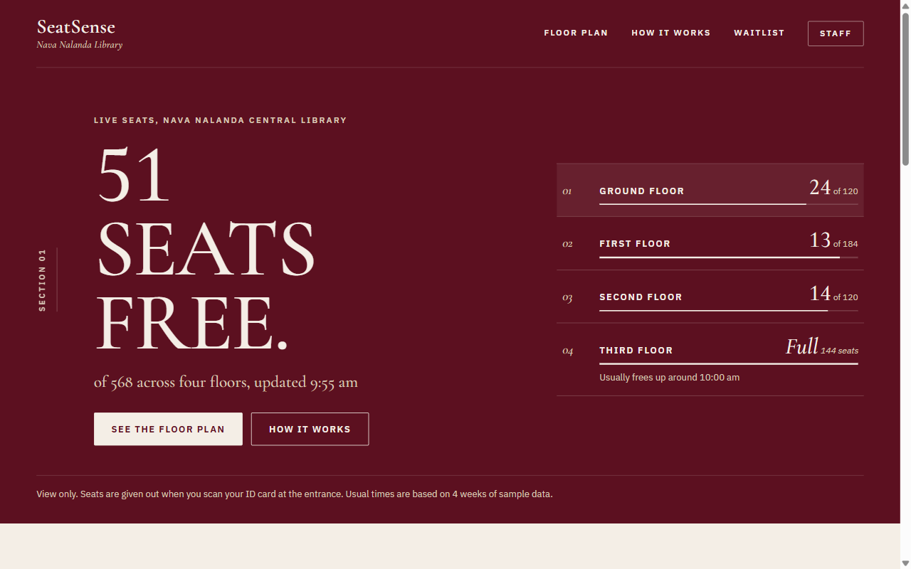
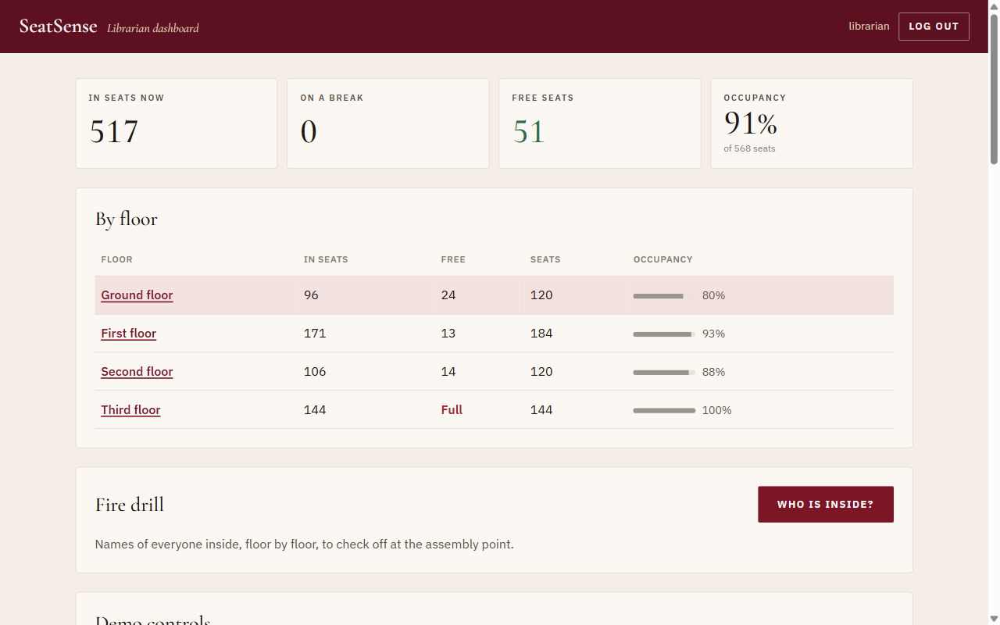
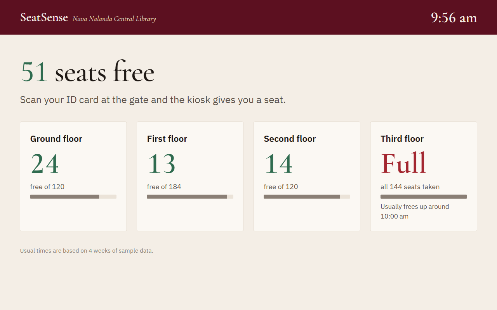
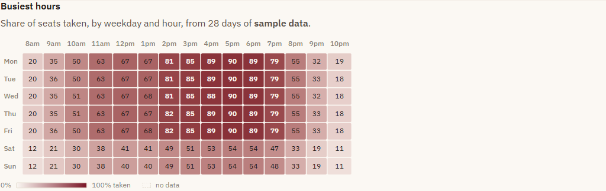

# SeatSense

[](https://github.com/bhavyammisra/seatsense-java-project/actions/workflows/ci.yml)

A live seat finder for a university library, built on Spring Boot and React for our Enterprising Web Applications (Java) course.

In exam season our library fills up by the afternoon. Students walk through all four floors and leave without a seat, and nobody can tell from outside whether there is space. SeatSense works from the ID card scan the library already has at its entrance. Scanning in gives you a seat, scanning out frees it, so the system always knows which seats are free and can show that to everyone, live.



All students, cards, accounts and history in this repo are **sample data**, never real people.

## What it does

**At the gate**
- A phone camera reads the student's ID barcode. The kiosk says "Welcome", shows every floor's seat map and lets them tap a seat.
- "Best seat for me" ranks free seats by the student's preferences. Untouched for 10 seconds, the kiosk assigns the best one so the queue keeps moving.
- "Sit together" finds 2 to 4 free seats side by side for friends who scan in together.
- Scanning out asks "Leaving" or "Break (30 min)". A break holds the seat and frees it automatically if the student does not return.

**For students**
- A public, view-only page shows free seats per floor, updated the moment anything changes. Booking from a hostel room is deliberately not possible.
- When a floor is full: a waitlist that offers the next freed seat with a timed hold, and an alert for "tell me when Floor N has 5+ free seats".
- "Seats usually free up around 7:30 pm", worked out from past weeks of occupancy.

**For library staff**
- A dashboard with live headcount and occupancy per floor, and seats that can be taken out of service.
- Analytics: busiest hours by weekday, most-used seats, and how often students saw the library full.
- A fire-drill list of everyone inside, floor by floor, that prints for the assembly point.
- An entrance display board for a TV by the door.

| Dashboard | Entrance display |
|---|---|
|  |  |



## The Java worth reading

| What | Where | How |
|---|---|---|
| One seat, one person | [`ConcurrencyProofTest`](backend/src/test/java/com/seatsense/session/ConcurrencyProofTest.java) | Partial unique indexes in Postgres guarantee one open session per seat and per student. The test sends 200 threads at one seat: exactly one wins. |
| No seat both held and taken | [`SeatHoldRaceTest`](backend/src/test/java/com/seatsense/waitlist/SeatHoldRaceTest.java) | The waitlist locks the seat row (`PESSIMISTIC_WRITE`) before offering it, so a hold and a gate scan cannot both win. |
| Best seat for me | [`BestSeatRanker`](backend/src/main/java/com/seatsense/allocation/BestSeatRanker.java) | Scores every free seat on how many of the student's wishes it meets (power, window, quiet zone), how quiet its neighbours are, how far the walk is, and whether it was their last seat. A bounded `PriorityQueue` keeps only the top few. |
| Sit together | [`GroupSeatFinder`](backend/src/main/java/com/seatsense/allocation/GroupSeatFinder.java) | Same row first, then same table, then a breadth-first search over neighbouring seats. All seats are taken in one transaction. |
| Seat states | [`SeatStateMachine`](backend/src/main/java/com/seatsense/session/SeatStateMachine.java) | FREE, HELD, TAKEN, ON_BREAK and OUT_OF_SERVICE, with every legal move listed and everything else refused. |
| Waitlist | [`WaitlistService`](backend/src/main/java/com/seatsense/waitlist/WaitlistService.java) | A first-in, first-out queue. A freed seat goes to the head of the queue as a 15-minute hold, then passes on if not taken. |
| Predictions | [`PredictionService`](backend/src/main/java/com/seatsense/analytics/PredictionService.java) | Averages free seats per 15-minute slot on the same weekday over the last 4 weeks and finds the first later slot with 5 or more. With no history it says nothing rather than guess. |
| Live updates | [`CoalescingThrottle`](backend/src/main/java/com/seatsense/analytics/CoalescingThrottle.java) | Domain events go out over STOMP WebSockets. During a rush, availability updates are merged so screens get at most two a second, and the last change is never lost. |
| Time | [`TimeProvider`](backend/src/main/java/com/seatsense/common/TimeProvider.java) | All time goes through one injectable clock, so tests use fixed times and the demo can fast-forward 30 minutes. |
| Exam rush | [`SimulatorService`](backend/src/main/java/com/seatsense/simulator/SimulatorService.java) | Dev-only: fills the library floor by floor like an exam evening, and writes 4 weeks of sample history labelled as sample. |

Every behaviour has a test. `./mvnw verify` runs over 200 of them, most against a real Postgres started by Testcontainers, and CI runs them on every pull request.

## Tech stack

| Layer | Choice |
|---|---|
| Backend | Java 21, Spring Boot 3.5 (Web, Data JPA, Security, WebSocket, Validation, Scheduling) |
| Database | PostgreSQL 16, schema in Flyway migrations |
| Live updates | STOMP over WebSocket |
| Frontend | React, TypeScript, Vite |
| Tests | JUnit 5, Spring Boot Test, Testcontainers |
| Build and CI | Maven wrapper, GitHub Actions |
| Hosting | Docker image on Render (see "Hosted demo") |

```
 Phone scanner page ─┐
 Gate kiosk ─────────┤        ┌──────────────────────────────┐
 Public site ────────┼─HTTP──▶│  Spring Boot backend         │──▶ PostgreSQL
 Student portal ─────┤◀──WS───│  gate · session · allocation │
 Librarian dashboard ┘        │  waitlist · analytics · auth │
                              │  simulator (dev only)        │
                              └──────────────────────────────┘
```

## Repository layout

```
backend/     Spring Boot app: one Java package per module (gate, session, allocation, waitlist, analytics, ...)
frontend/    React app: one folder per screen (kiosk, scanner, public, portal, dashboard, display, cards)
docs/        PROJECT.md (the full design), WORKPLAN.md (who built what), api.md (the API), decisions.md
Dockerfile   Builds the frontend into the Spring Boot jar, one image for everything
render.yaml  The hosted demo: one web service and a Postgres database
```

## Team

Built by **Shefali**, **Bhavyam Misra** and **Tushita Jindal**. [docs/WORKPLAN.md](docs/WORKPLAN.md) records who owned which module and every task, phase by phase. [docs/PROJECT.md](docs/PROJECT.md) has the full design: the problem, the decisions behind it, the data model and the algorithms.

## Run the backend

You need JDK 21 or newer and a Postgres 16 database. Maven is not needed: the repo has a Maven wrapper.

The steps below use Docker Desktop for Postgres. Without Docker, any local Postgres 16 works (for example `brew install postgresql@16` and `brew services start postgresql@16` on a Mac): create a database and user with the same values as in your `.env`, skip step 2, and carry on.

1. Create your `.env` from the example and set your own password in it:
   ```
   cp .env.example .env
   ```
2. Start Postgres:
   ```
   docker compose up -d
   ```
3. Start the backend (profile `local` is the default):
   ```
   cd backend
   ./mvnw spring-boot:run
   ```
   On Windows PowerShell use `.\mvnw.cmd spring-boot:run`.

   Always start the backend from the `backend/` folder (this applies to `java -jar` too). It reads the database settings from `../.env`, so started from anywhere else it will not find them.
4. Check it is up: http://localhost:8080/actuator/health should show `{"status":"UP"}`.

On a local run the backend creates **sample** login accounts, all with the `SAMPLE_PASSWORD` from your `.env`: `gate` (scanner and kiosk), `librarian` and `admin` (dashboard), and `sample.student1` to `sample.student5` (linked to the sample students). If `SAMPLE_PASSWORD` is empty it skips them and logs a warning.

The frontend talks to the API with a session cookie. Every POST, PUT and DELETE must send the `XSRF-TOKEN` cookie's value in an `X-XSRF-TOKEN` header, or it is refused with 403.

Flyway applies every migration in `backend/src/main/resources/db/migration` on startup.

To use the demo-only features (the simulator and its buttons on the dashboard), run with the `dev` profile instead:
```
./mvnw spring-boot:run -Dspring-boot.run.profiles=dev
```

Stop Postgres with `docker compose down`. Your data stays in a Docker volume; `docker compose down -v` deletes it.

## Run the tests

```
cd backend
./mvnw verify
```

Docker must be running: database tests start their own throwaway Postgres with Testcontainers, so they do not touch your local data. Any test that needs the database extends `PostgresIntegrationTest`.

## Profiles

| Profile | Used for | Database |
|---|---|---|
| `local` (default) | Running on your machine | Postgres from `docker-compose.yml`, settings from `.env` |
| `dev` | Demo rehearsal: `local` plus simulator endpoints | Same as `local` |
| `test` | Automated tests | Testcontainers |
| `cloud` | The hosted demo (see "Hosted demo"): sample accounts and simulator on, serves the built frontend too | From the host's `DB_*` settings |

## Run the frontend

You need Node 24 (or 22). In a second terminal:
```
cd frontend
npm ci
npm run dev
```
Open http://localhost:5173. The dev server sends `/api` and `/ws` to the backend on port 8080.

| Page | Who | Log in as |
|---|---|---|
| `/` | Anyone: live free seats and floor maps, "Join the waitlist" when full | nobody |
| `/kiosk` | The screen at the library gate | `gate` |
| `/scanner` | The phone that scans ID cards at the gate | `gate` |
| `/portal` | Students: waitlist place and held-seat offers | `sample.student1` to `sample.student5` |
| `/dashboard` | Library staff: headcount, occupancy, out-of-service seats, demo controls | `librarian` or `admin` |
| `/cards` | Printable **sample** ID cards with barcodes for the demo | nobody |

All students, cards and accounts above are sample data, never real people.

## Demo on phones (local laptop)

The hosted demo needs none of this. Use it only when running everything from one laptop.

The scanner and portal run on phones that open the laptop by its network address (for example `https://192.168.1.5:5173`). Two things are needed:

1. **https**, because phones only allow the camera on a secure address. With [mkcert](https://github.com/FiloSottile/mkcert):
   ```
   mkcert -install
   mkcert 192.168.1.5 localhost
   ```
   Then start the frontend with the two files it printed:
   ```
   SEATSENSE_HTTPS_CERT=./192.168.1.5+1.pem SEATSENSE_HTTPS_KEY=./192.168.1.5+1-key.pem npm run dev
   ```
   Each phone must trust mkcert's root certificate (`mkcert -CAROOT` shows where it is), or accept the warning once.
2. **Allow the phone's origin for live updates.** Start the backend with the laptop's address added:
   ```
   SEATSENSE_WS_ALLOWED_ORIGINS="https://192.168.1.5:5173,http://localhost:[*]" ./mvnw spring-boot:run -Dspring-boot.run.profiles=dev
   ```

The laptop and phones must be on the same network (a phone hotspot works).

## Hosted demo

The demo runs online on [Render](https://render.com) as one web service plus a Postgres database, both described in `render.yaml`. The `Dockerfile` builds the React app and puts it inside the Spring Boot jar, so the pages, the API and live updates share one https address. Phones can open the scanner and portal with no certificates and no shared Wi-Fi.

To set it up (once):

1. Sign in to Render with GitHub and give it access to this repository.
2. New, then Blueprint, then pick this repository. Render reads `render.yaml`.
3. When asked for `SAMPLE_PASSWORD`, enter the password the sample accounts (`gate`, `librarian`, `admin`, `sample.student1` to `5`) should use. Keep it out of the repo.
4. Apply. The first build takes a few minutes. The address appears at the top of the `seatsense` service, for example `https://seatsense-xxxx.onrender.com`. Open `/kiosk`, `/scanner`, `/portal`, `/dashboard` or `/cards` on it.

Things to know about the free plan:

- The service sleeps after 15 minutes without visits, and the first visit after that takes about a minute. Open the site a few minutes before presenting.
- The free database expires 30 days after it is created. Create the blueprint close to the presentation date, or move to a paid plan.
- Only sample data goes here. The simulator is on so the demo script works; reset it from the dashboard after rehearsing.

The site has a privacy policy at `/privacy` and terms at `/terms`, linked from the public page. Set a strong `SAMPLE_PASSWORD`: anyone on the internet can reach the login.

Every push to `main` redeploys automatically.

## Demo script

PROJECT.md Section 16, with the backend on the `dev` profile:

1. Laptop: `/kiosk` (as `gate`) on the projector. Phone: `/scanner` (as `gate`). Second laptop tab: `/dashboard` (as `librarian`). Print `/cards`.
2. Scan a sample card: the kiosk says "Welcome", counts down 10 seconds and gives the best seat, or tap one. The public site and dashboard update at once.
3. Choose 2 seats on the kiosk and let a friend scan: they sit together.
4. Dashboard, **Exam evening rush**: the library fills floor by floor and the top floor shows Full.
5. On a phone, `/portal` as `sample.student1`: join the waitlist.
6. Scan out someone on the right floor with **Leaving**: the portal shows the held seat at once. Accept, scan that student's card: the kiosk offers "Take my held seat".
7. **Clock +30 min** shows breaks and offers running out and passing to the next person.
8. Dashboard: click a free seat to take it out of service. **Reset** clears everything for the next run.

## Concurrency proof

`session/ConcurrencyProofTest` sends 200 threads through the real session service at once: 200 students on one seat (exactly 1 wins), one student on every seat of a floor (exactly 1 seat), and 200 exits of one session (freed once). It runs in CI with every other test.

